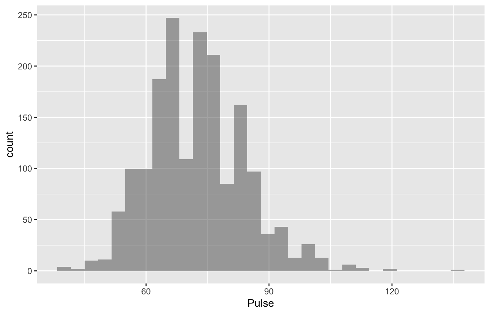

# NHANES-pulse-predictive-modeling

Statistical analysis of NHANES health data using R, including data screening, feature engineering, descriptive statistics, and exploratory visualizations. Regression modeling and evaluation are planned for later stages.

## Project overview

**Research question:** Which demographic, health, and lifestyle variables are associated with resting pulse rate among U.S. adults, and how well can multiple linear regression predict pulse?

This project uses the 2011–2012 NHANES training dataset to investigate resting pulse rate (beats per minute). The analysis includes data inspection, missing-value assessment, exploratory visualization, and feature engineering.

The analysis is organized in **one R Markdown notebook**. The findings so far are descriptive and do not establish cause-and-effect relationships.

## 1. Project structure

```text
nhanes-pulse-predictive-modeling/
├── data/
│   └── NHANES-training.csv         # Training dataset (1,807 rows; 66 columns)
├── figures/                        # Pulse and numerical predictor histograms
├── NHANES_Pulse_Analysis.Rmd       # Analysis notebook
└── README.md                       # Project overview and instructions
```

The R Markdown notebook contains the analysis, and the `figures/` folder contains 13 exported histograms.

## 2. Prerequisites

- **R** and **RStudio** (recommended)
- R packages: `rmarkdown`, `knitr`, `mosaic`, and `ggformula`
- **Pandoc** (included with RStudio; required to render the notebook)
- The training dataset at `data/NHANES-training.csv`

Install the R packages in R or the RStudio console:

```r
install.packages(c("rmarkdown", "knitr", "mosaic", "ggformula"))
```

## 3. How to run the project

**Option A — RStudio:**

1. Download or clone this repository and open the folder in RStudio.
2. Open `NHANES_Pulse_Analysis.Rmd`.
3. Select **Knit** to run the analysis and render the report.

**Option B — Terminal:**

Run the following command **from the repository root**:

```bash
Rscript -e 'rmarkdown::render("NHANES_Pulse_Analysis.Rmd")'
```

The notebook reads the dataset using a relative path, so no absolute file paths are required.

## 4. Dataset

The supplied `NHANES-training.csv` contains **1,807 observations and 66 columns** from a 2011–2012 National Health and Nutrition Examination Survey (NHANES) training sample. The outcome variable is **`Pulse` (beats per minute)**, with 47 missing Pulse values.

This is a training subset. Results are not weighted population estimates and should not be interpreted as representative of all U.S. adults.

## 5. Exploratory data analysis

The exploratory stage investigates missing values, variable distributions, and unusual observations before regression modeling.

| EDA finding | Observation |
| --- | --- |
| High missingness | `PhysActiveDays`: **52.7%**; `AlcoholDay`: **33.3%** |
| Derived variable | `SmokeStatus` constructed from `Smoke100` and `SmokeNow` |
| Pulse distribution | Mean **72.62 bpm**, median **72 bpm**; range **40–136 bpm** |
| Numerical predictors | Histograms and summary statistics for **12 variables**, including age, BMI, blood pressure, cholesterol, sleep, and alcohol frequency |
| Distribution patterns | Several measures are right-skewed; age and poverty have upper-coded values; poor-health day counts are concentrated at zero |

Unusually high or low measurements were flagged for further examination rather than automatically removed.

### Pulse distribution



The remaining predictor histograms are available in the `figures/` folder.

## 6. Regression modeling

Variable screening and exploratory comparisons provide the basis for regression modeling. **Model fitting, interaction effects, and model evaluation have not yet been completed.**

## 7. Results and interpretation

Resting Pulse is centered near **72 bpm**, with a slightly right-skewed distribution. BMI and systolic blood pressure are also right-skewed, while poor physical and mental health days have many zero responses. Some predictors contain unusual observations or reporting limits that will need consideration during modeling.

These are descriptive findings, not causal effects or validated individual predictions.

## 8. Skills and tools demonstrated

**R · R Markdown · Data inspection · Missing-data profiling · Feature engineering · Descriptive statistics · Histograms · Outlier screening**

## 9. Data references

- [CDC: National Health and Nutrition Examination Survey (NHANES)](https://www.cdc.gov/nchs/nhanes/)
- [2011–2012 NHANES Demographics Documentation](https://wwwn.cdc.gov/Nchs/Data/Nhanes/Public/2011/DataFiles/DEMO_G.htm)
- [2011–2012 NHANES Blood Pressure Documentation](https://wwwn.cdc.gov/Nchs/Data/Nhanes/Public/2011/DataFiles/BPX_G.htm)
